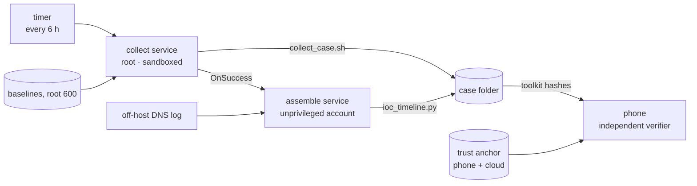

# 鬼火 · Liao IOC Timeline

**A self-checking Linux host, run from an iPhone.**

> **What it is:** a small, stdlib-only Python toolkit that lets a single Linux VPS inspect itself every 6 hours.
> - It assembles the findings into **one chronological, correlated incident timeline**.
> - It keeps a **trust anchor off the host** (on the phone and in iCloud), so you can check whether the inspector itself has been tampered with.
>
> It was built and run entirely from an iPhone (Termius + Pythonista). It makes no AI or model calls at runtime.

**The analogy used throughout:** treat the server as a patient on **q6h labs**.
- **The tools:** the analyzers.
- **The baselines:** the patient's own reference ranges.
- **The anchor:** the QC calibrator, kept outside the instrument.
- **The timeline:** the cumulative lab report a clinician reads.

---

## Architecture



**One run, start to finish:**
1. **Collect.** Runs as root inside a hardened systemd sandbox. It reads processes, sockets, the auth log, the persistence surface, accounts, log health and file hashes, then diffs each against its baseline.
2. **Assemble.** Runs as an unprivileged account. It pulls the **off-host** DNS log and merges every source into one timeline. Each event is tagged with a severity, an incident phase and an actor thread.
3. **Verify.** Done on the phone, by code that never touches the server. It compares the run's toolkit hashes against the anchor and runs three spiked tamper controls.

---

## Repository layout

```
liao/                 server toolkit -> install to /opt/liao (root:root)
  *.py                the ten eyes + ioc_timeline assembler (stdlib only)
  collect_*.sh        read-only collectors (persistence, accounts, log integrity)
  collect_case.sh     root collector: writes one case folder per run
  assemble_case.sh    unprivileged assembler: DNS + timeline
  ANCHOR_FILES        the files whose hashes define "the inspector"
systemd/              liao-collect.service, liao-assemble.service, liao-timeline.timer
etc/liao.conf.example site settings (admins, service users, FIM exclusions)
phone/                Pythonista verifiers (never import server code)
tools/                review_case.py / review_detail.py (one-screen case summaries)
examples/             sample report (placeholder data)
```

Install: see [INSTALL.md](INSTALL.md). Sample output: [examples/sample-timeline.md](examples/sample-timeline.md).

## The toolkit

| Tool | Job | Lab analogy |
|---|---|---|
| **fim** | Hashes the code, the service tree and the systemd unit tree; reports anything modified, added or deleted | **Tamper seals on specimen tubes** |
| **persistence_audit** | Cron, systemd units and timers, authorized_keys, login hooks, `ld.so.preload`, all diffed against the baseline | **Line check on rounds:** any new line that isn't in the chart |
| **account_audit** | Accounts, groups, sudoers, effective sshd config, last logins, account-file permissions | **The badge-access roster** |
| **log_integrity** | Log gaps, in-place truncation, rotations, journal verification, logging-service restarts, reboots, shell-history tricks | **Chain of custody:** a gap is a finding by itself |
| **log_parser** | Turns `auth.log` into events and brute-force clusters | **The door-swipe log** |
| **proc_inventory** | Process tree; flags code running from `/tmp`, deleted binaries, fake kernel threads, service users spawning shells | **The unit census** |
| **conn_inventory** | Active sockets, outbound traffic linked to the process that owns it | **The live phone board** |
| **dns_parser** | Off-host DNS log analysis: beaconing, random-looking (DGA) names, newly registered domains, DNS bypass | **The carrier's outgoing call log,** which the patient can't edit |
| **rep_lookup** | AbuseIPDB + VirusTotal, cross-referenced, only when asked | **The national exclusion list** |
| **ioc_timeline** | Merges every source into one ranked, correlated timeline; verifies the trust anchor | **The cumulative lab report** |

**The pipeline and its trust layer:**
- `collect_case.sh` and `assemble_case.sh`, run by systemd units.
  - The **collector's sandbox** includes no network (`IPAddressDeny=any`, Unix/netlink sockets only), `ProtectKernel*`, `@system-service` syscalls only, `RestrictSUIDSGID` and namespace limits. systemd's exposure score dropped from **8.8 to 3.5**.
  - The **assembler** runs with an empty set of capabilities.
- An **anchor allowlist** of 23 files: the tools, the pipeline scripts, the 4 baselines and the 3 units. Their fingerprints are stored **off the host**, along with copies of the baselines.
- A **phone-side verifier** that also runs three in-memory tamper tests: one changed byte in a tool, a deleted baseline and a planted file. All three must be caught.

---

## Build log (condensed)

| Phase | What | Analogy |
|---|---|---|
| Prep | Clock sync, SSH restricted to one user, root-owned code directory, secrets in a root-only env file readable by one service account | Calibrate the instruments; lock the narcotics cabinet |
| Admission | First manual collection; every finding attributed before anything was called "normal" | Admission labs |
| Baselines | 4 baselines built and stored root-only, with copies sent off-host and verified | Reference ranges, plus a split specimen to the reference lab |
| Pipeline | Collect → assemble chained in systemd; secret-leak check (0 hits) | Standing q6h order |
| Review | Every high and medium finding attributed (a tunnel daemon's hourly check, phone CDN traffic, a daily lynis rewrite, the operator's own password-reset session reconstructed from the logs) | Reviewing critical values before releasing results |
| Tuning | Fixed a persistence bug that flagged every timer on every run; allowlisted CDN hash-style hostnames | Fixing a delta-check rule that flagged every patient |
| Hardening | Collector sandbox 8.8 → 3.5 | Isolation precautions |
| Anchor | 23 fingerprints plus baseline copies moved off-host; verified twice | QC calibrator kept in another building |
| Go-live | End-to-end run; phone verified 23/23; all 3 tamper controls caught; timer enabled | QC with spiked controls before go-live |
| Patch cycle | Snapshot → OS updates → reboot → every change traced to the update window → re-baseline → new anchor → re-verify | Software upgrade on the analyzer, then recalibration |

---

## Limits (please poke holes)

- **The toolkit hashes are computed on the host.** The anchor check proves the toolkit is intact *as the host reports it*. A kernel-level rootkit that intercepts reads could hand back clean bytes, and the check would still pass.
  - **The fix I'm considering:** verify from outside the running kernel, by hashing a provider snapshot or a detached volume from another machine, or by booting a rescue image and hashing from there.
  - **Your approaches welcome.** What do you use for out-of-band integrity on a single cloud VM?
- **Almost all telemetry is self-reported.** The DNS log is the only fully off-host source, and encrypted-DNS apps on client devices bypass it.
- **Most baseline drift is collected, but the timeline doesn't read it yet.** The persistence, account and log compares are saved with each run but not merged into the timeline. That's next.
- **Known noise still being tuned:** an auth-log rule that scores the text of sudo commands as failed logins, and a DNS random-name check that always fills its top-N list.

---

## Stack

- **Language:** Python standard library only, plus POSIX `sh`.
- **Scheduling and isolation:** systemd units and a timer.
- **Phone side:** Pythonista (the verifier never imports server code) and Termius.
- **Server:** Ubuntu 24.04, a single VPS.

## License

MIT. Use only on systems you own or are authorized to assess.
